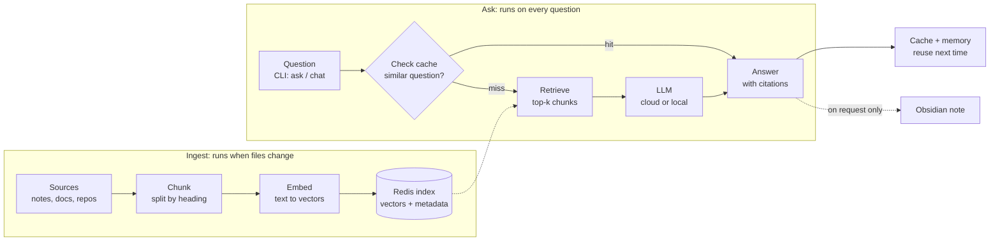

# Architecture Overview

**Two flows share one Redis Stack: ingestion fills it, and every question reads from it, checking the cache before anything else.**

A cache hit returns at once. A miss retrieves chunks from Redis, asks the LLM, then stores the answer in the cache and memory. A note reaches Obsidian only on request.

## Technology choices

| Layer | Choice | Reason |
| --- | --- | --- |
| Language | Python 3.11 or newer | Best-supported path for RedisVL ([ADR 0002](decisions/0002-python-and-redisvl.md)) |
| Store | Redis Stack in Docker Compose | Vector search, JSON and caching in one container ([ADR 0001](decisions/0001-use-redis-stack.md)) |
| Redis library | RedisVL | Ready-made vector index, semantic cache and message history |
| LLM and embeddings | Provider adapters; cloud default, Ollama optional | Swap by config without code changes ([ADR 0003](decisions/0003-pluggable-providers.md)) |
| Obsidian access | Direct read and write of the vault folder | Works with Obsidian closed; an Obsidian MCP can be added later ([ADR 0004](decisions/0004-vault-write-back-safety.md)) |
| Web docs | HTTP fetch plus HTML-to-text conversion | Simple, no browser needed for most documentation sites |
| Interface | Command-line program | Fast to build and test; a UI is out of scope for v1 |
